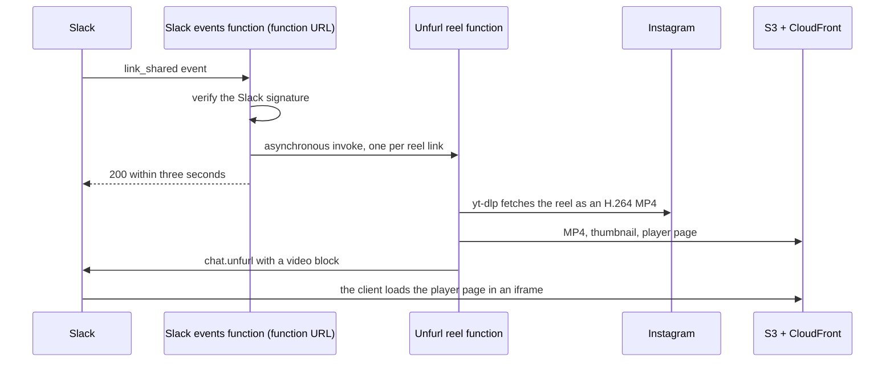

# About the architecture and its costs

## Request flow

Slack expects an answer to an event within three seconds, and a download takes longer. The events
function answers at once and hands the work to the worker through an asynchronous invoke.

A Slack video block plays an embeddable page, not a video file, and that page must be on one of the
app's unfurl domains. That is why the stack serves a small HTML player page from its own domain.

The worker downloads reels with yt-dlp, for the reasons in
[ADR 1: Download reels with yt-dlp](../adr/0001-download-reels-with-yt-dlp.md). It keeps the
progressive MP4 that Instagram serves, which is H.264 and plays on iOS. Higher resolutions come as VP9
or as separate video and audio streams, which need ffmpeg and, for VP9, do not play on iOS. Keeping
the progressive file caps videos at 720p and keeps the function a dependency-light zip.

## Data lifecycle

Each reel produces three objects in a private bucket: `reels/<id>.mp4`, the thumbnail, and
`v/<id>`, the player page. A lifecycle rule expires them one day after upload, and S3 removes them
within the following day. CloudFront can serve a cached copy for up to one more day. After that, the
player in Slack stops working and the original Instagram link remains.

Logs are kept one day. Application logs record the Slack channel, not the reel URL, because Instagram
share links carry tracking parameters. An error raised by yt-dlp can still include the URL in the
error log.

## Costs

Under normal use, unfurly stays within the AWS free tiers and costs close to nothing. Two
mechanisms bound the cost of abuse:

- **The media CDN** is on the CloudFront Free flat-rate plan, which has no overage charges. Traffic
  beyond the plan allowance can be slowed down, never billed. The plan requires a WAF web ACL, which
  the plan includes. See
  [ADR 2: Protect the media CDN with the CloudFront Free plan](../adr/0002-protect-the-media-cdn-with-the-cloudfront-free-plan.md).
- **The Slack events function URL** is public and outside the plan: every request, even a rejected
  one, runs the function. Its reserved concurrency of 2 limits concurrent executions, and Lambda
  throttles the excess. Lambda system logs are limited to warnings. A CloudWatch alarm triggers a kill
  switch that disables the function when invocations exceed a threshold. See
  [ADR 3: Bound the Slack events cost with a kill switch](../adr/0003-bound-the-slack-events-cost-with-a-kill-switch.md).

The remaining fixed costs are the SSM parameter (free in the standard tier), the CloudWatch alarm
(within the ten free alarm metrics), and the SAM artifacts in S3 (a few megabytes).

## Security

The Slack events function URL accepts unauthenticated requests, because Slack cannot sign AWS
requests. The function rejects any request whose Slack signature does not match the signing secret,
and acknowledges Slack retries without processing them again.

The GitHub Actions deploy role has `AdministratorAccess`. Its trust policy accepts only workflows from
`GitHubRepository` that run in `GitHubEnvironment`. If that environment has required reviewers, they
approve every deployment.
